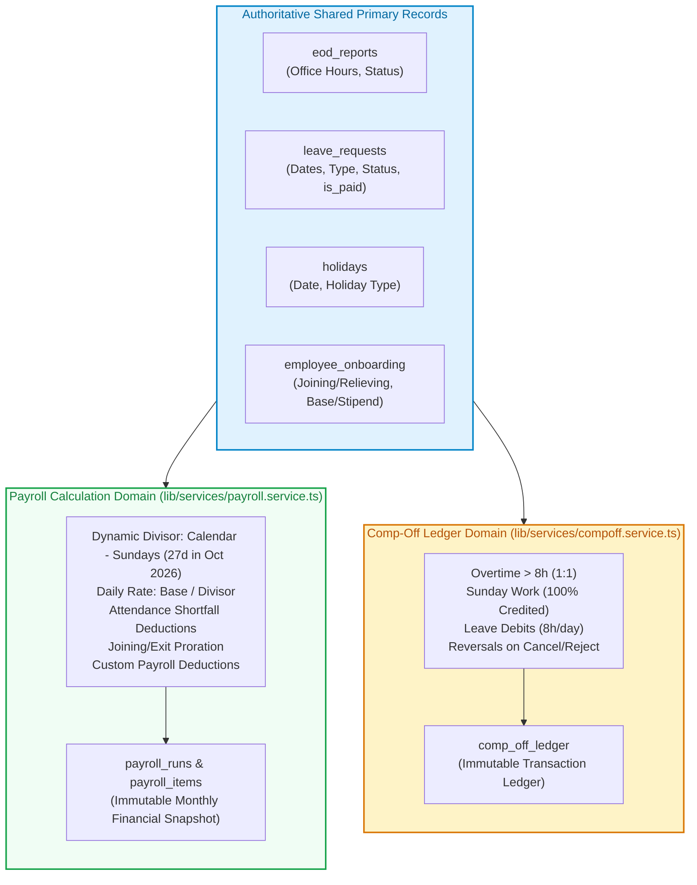

# TripleS ERP — Payroll & Comp-Off Architectural Separation

**Document Version:** 1.0.0-PROD  
**Author:** DeepMind Agentic Coding Architecture Team  
**System:** TripleS ERP Enterprise Core  
**Compliance Standard:** Complete Calculation Independence & Ledger Immutability  

---

## 1. Executive Summary & Architectural Principles

The Payroll and Compensatory Off (Comp-Off) calculation engines are refactored into **two completely decoupled, autonomous domain systems**. 

Under this decoupled architecture:
1. **Zero Financial Dependency on Comp-Off:** Salary, daily wage rates, attendance deductions, and net payable compensation **never** incorporate, multiply, or depend on an employee's Comp-Off balance, credited hours, or extra hours. Cash overtime is strictly ₹0.00.
2. **Zero Payroll Mutation of Comp-Off Ledger:** The payroll calculation engine (`calculateMonthlyPayroll`) is strictly **read-only** with respect to `comp_off_ledger`. Running, previewing, adjusting, or recalculating payroll drafts can **never** insert, update, or delete Comp-Off ledger entries.
3. **Independent Comp-Off Engine:** The Comp-Off module independently computes extra hours beyond 8h, Sunday shifts (100% credited), and processes debits and reversals upon leave lifecycle events without reading or altering payroll runs or salary structures.
4. **Singular Permitted Interaction (Shared Data Contract):**
   - When an approved leave has `request_type === 'Compensatory Off'` or `leave_type === 'Compensatory Off'`, **Payroll** evaluates it as a **Paid Leave** (pay fraction: `1.0`, attendance deduction: `₹0.00`).
   - Simultaneously and independently, the **Comp-Off Module** processes an immutable `DEBIT` transaction in `comp_off_ledger` for `8.0 hours` (or `4.0 hours` if half-day).
   - Neither engine reads or relies on the other's internal transactions or database records to complete its work.

---

## 2. Module Boundaries & Responsibilities



### Payroll Module Domain Scope
- **Authoritative Files:** `lib/services/payroll.service.ts` & `lib/services/payroll-records.service.ts`
- **Inputs:** `employee_onboarding`, `salary_history`, approved `eod_reports`, `leave_requests`, `holidays`, `payroll_deductions`.
- **Outputs:** `PayrollResult[]`, persistent snapshots in `payroll_runs` and `payroll_items`.
- **Calculations:**
  - Base monthly stipend or basic salary with effective-date salary hike splits.
  - Dynamic working days divisor: $\text{Calendar Days} - \text{Sundays}$ in `Asia/Kolkata` (`actual_mon_sat`).
  - Shift classifications:
    - $\ge 8\text{h}$: Full-Day ($1.0$ pay, $0$ deduction).
    - $4\text{h}$ to $<8\text{h}$: Half-Day ($0.5$ pay, $0.5$ deduction).
    - $<4\text{h}$: Unpaid Day ($0.0$ pay, $1.0$ deduction; worked time eligible for comp-off under separate module).
  - Joining/relieving date proration.
  - Attendance shortfall deductions: $\text{Total Deducted Days} \times \frac{\text{Base Salary}}{\text{Divisor}}$.
  - Employee custom deductions applied independently.
  - Final net payable salary: $\text{Base} - \text{Attendance Deductions} - \text{Custom Deductions}$.
- **Strict Invariance:**
  $$\text{Payable Days} + \text{Deducted Days} \equiv \text{Scheduled Working Days}$$
  $$\text{Net Payable} + \text{Total Deductions} \equiv \text{Base Salary}$$

### Comp-Off Module Domain Scope
- **Authoritative Files:** `lib/services/compoff.service.ts` & `lib/actions/compoff.ts`
- **Inputs:** approved `eod_reports`, `leave_requests`, `holidays`.
- **Outputs:** Transaction rows in `comp_off_ledger`, real-time balances.
- **Calculations:**
  - Standard day threshold: 480 minutes (8.0 hours).
  - Weekday overtime: worked minutes beyond 480 credited 1:1.
  - Sunday shifts: 100% of worked minutes credited to Comp-Off.
  - Holiday worked shifts: 100% of worked minutes credited to Comp-Off (while Payroll separately pays the holiday base).
  - Approved Comp-Off leave: debits approved hours ($8.0\text{h}$ per full day, $4.0\text{h}$ per half day).
  - Reversals: when an approved Comp-Off leave is subsequently cancelled or rejected, an explicit `REVERSAL` transaction restores the debited hours.
- **Strict Invariance:**
  $$\text{Closing Balance} \equiv \text{Opening Balance} + \text{Approved Credits} - \text{Approved Debits} + \text{Reversals}$$

---

## 3. Database Schema & Idempotency Constraints

To guarantee that duplicate transactions cannot occur even under extreme concurrent calls or retried network requests, database-level unique constraints and indexes have been enforced:

```sql
-- 1. Prevent duplicate CREDIT entries for the same EOD report
CREATE UNIQUE INDEX IF NOT EXISTS idx_comp_off_ledger_unique_credit 
  ON public.comp_off_ledger(reference_id, transaction_type) 
  WHERE transaction_type = 'CREDIT' AND reference_id IS NOT NULL;

-- 2. Prevent duplicate DEBIT entries for the same Leave Request
CREATE UNIQUE INDEX IF NOT EXISTS idx_comp_off_ledger_unique_debit 
  ON public.comp_off_ledger(reference_id, transaction_type) 
  WHERE transaction_type = 'DEBIT' AND reference_id IS NOT NULL;

-- 3. Prevent duplicate REVERSAL entries for the same Leave Request
CREATE UNIQUE INDEX IF NOT EXISTS idx_comp_off_ledger_unique_reversal 
  ON public.comp_off_ledger(reference_id, transaction_type) 
  WHERE transaction_type = 'REVERSAL' AND reference_id IS NOT NULL;

-- 4. Fast composite index for balance aggregation
CREATE INDEX IF NOT EXISTS idx_comp_off_ledger_emp_type_created 
  ON public.comp_off_ledger(employee_id, transaction_type, created_at ASC);
```

### Concurrency Protection Mechanism
In addition to database-level unique indexes, `lib/services/compoff.service.ts` implements in-memory in-flight deduplication locks (`inFlightCredits` and `inFlightDebits`). If 5 identical approval requests arrive concurrently:
1. The first request registers its pending promise and executes.
2. The remaining 4 requests attach to the pending promise and return safely without issuing conflicting database queries.
3. If an insertion collides at the database level, PostgreSQL constraint violation error code `23505` is caught cleanly, ensuring absolute idempotency.

---

## 4. Finalization Safety & Guardrails

To prevent corrupt or invalid payroll records from ever entering production snapshots:
1. **Missing Salary Structure Protection:**
   - If an employee has `hasMissingSalary: true` (e.g. basic salary = null, salary = null, stipend = null), `finalizePayrollRun()` **blocks finalization** and returns a detailed validation error:
     `"Cannot finalize payroll: Unsafe finalization blocked. Missing or invalid salary structure detected for: Kavita Verma (EMP-011). Resolve salary structures or provide a formal audit override."`
   - Finalization can only proceed if an executive administrator explicitly provides `allowMissingSalaryOverride: true` and an auditable `auditOverrideReason`, which is permanently recorded in the immutable snapshot metadata.
2. **Snapshot Immutability:**
   - Once a payroll run is marked `FINALIZED` in `payroll_runs`, subsequent calls to `calculateMonthlyPayroll` or `finalizePayrollRun` will never overwrite the historical records.
